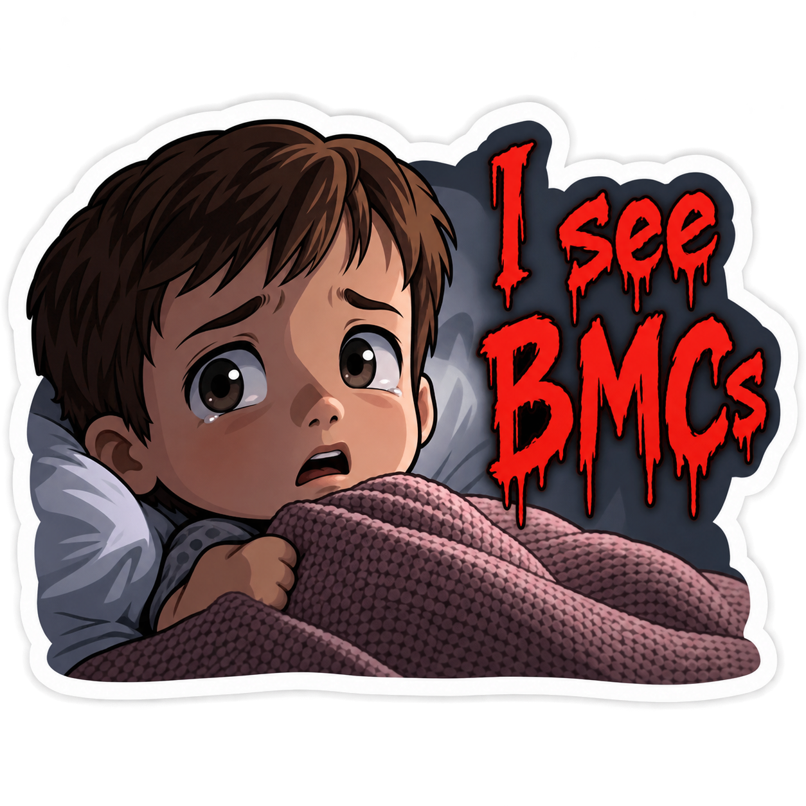

# Stickers

Source artwork, print exports, and purchase links for stickers by Lewis Denham-Parry.

## Gallery

The first sticker's artwork is ready. Its Redbubble product listing is pending.

| Preview | Sticker | Size | Finish | Licence | Buy |
| --- | --- | --- | --- | --- | --- |
|  | I See BMCs | 75 × 75 mm target | Glossy target | [CC BY 4.0](https://creativecommons.org/licenses/by/4.0/) | Listing pending |

## Adding a sticker

Put each sticker in `stickers/<slug>/`, using a short lowercase slug with hyphens. Keep these files together:

- `source.<ext>`: editable original artwork, preferably vector format.
- `print.<ext>`: print-ready PNG or PDF export at the dimensions accepted by the printer.
- `preview.<ext>`: small image for the README gallery, if the print export is unsuitable as a preview. The preview field may point to the print export.
- `metadata.yaml`: the sticker's name, physical size, finish, licence, and product URL.

`metadata.yaml` uses this schema:

```yaml
name: Example sticker
size_mm: [75, 75]
finish: matte
license: CC BY 4.0
source: source.svg
print: print.png
preview: preview.png
purchase_url: https://example.com/product-page
```

All fields are required. `size_mm` is the target `[width, height]` in millimetres. The file fields are paths relative to that sticker's directory. Set `purchase_url: null` until a product listing is published; then use its URL for the exact design. The gallery must say “Listing pending” until the buy URL resolves. A product's final size and finish must match its published listing.

The initial storefront choice is [Redbubble](https://www.redbubble.com/en/about/selling). Product listings and prices are managed in the owner's Redbubble artist account. The gallery links directly to each published sticker product, rather than to the general shop.

## Licensing

Artwork in `stickers/` is © Lewis Denham-Parry and licensed under [Creative Commons Attribution 4.0 International](https://creativecommons.org/licenses/by/4.0/), unless a sticker's metadata explicitly says otherwise. Attribute the creator as “Lewis Denham-Parry” and link to this repository and the licence when reusing an artwork file. The repository's `LICENSE` covers its software and configuration, not the sticker artwork.

## Contributing

Open a pull request with the source artwork, print export, metadata, and gallery row. Confirm that the artwork is yours to license and that the product link is live. The required `pre-commit` check validates repository formatting before a PR can merge.
